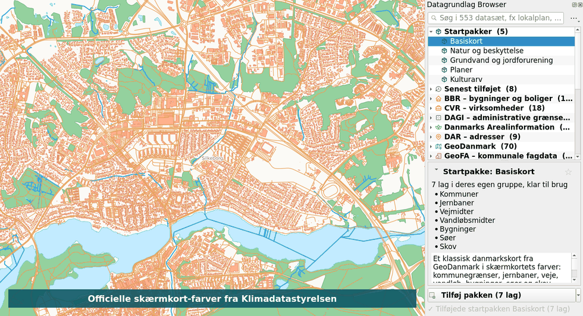
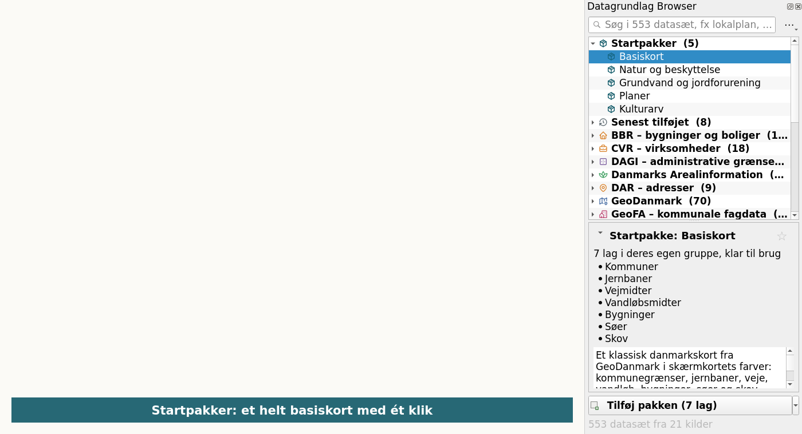

# Datagrundlag Browser – QGIS-plugin

Søg i 553 danske grunddata-datasæt fra [datagrundlag.dk](https://datagrundlag.dk/) og få dem ind på kortet – med farver og symboler, du kender.

*English: An unofficial QGIS plugin for [datagrundlag.dk](https://datagrundlag.dk/), an open catalogue of Danish public base data (BBR, Matriklen, GeoDanmark, Plandata.dk, GeoFA, nature and environment data). Search, add layers with ready-made styles, add starter packs, load only the current map extent, or go back in time. The user interface is in Danish.*

> Uofficielt plugin. Det er ikke lavet af eller tilknyttet datagrundlag.dk eller MapCentia.

## Hvad kan det?

- **Find data hurtigt** – 553 datasæt grupperet efter kilde (BBR, GeoDanmark …) eller tema (natur, planer, ejendomme …). Søgefeltet filtrerer med det samme.
- **Se, hvad du får** – beskrivelse, antal rækker, dato for de nyeste data, og om det er et kortlag eller en tabel.
- **Startpakker** – tilføj et helt basiskort, natur og beskyttelse, grundvand og jordforurening, planer eller kulturarv med ét klik – for hele landet eller kun dit kortudsnit.
- **Lag, der ser færdige ud** – GeoDanmark i Klimadatastyrelsens skærmkort-farver (vand er blå, skov er grøn …), GeoFA med de officielle GeoFA-symboler, Natura 2000 skraveret, kommunegrænser med navne. Alle lag lægges i gruppen *Datagrundlag* med beskrivelse og kilde i lagets metadata.
- **Store datasæt uden ventetid** – hent kun dit kortudsnit, eller tilføj det hele, så det først vises, når du zoomer ind.
- **BBR som punkter** – BBR-bygninger og tekniske anlæg (der kun har koordinater som tekst) bliver til punkter for dit kortudsnit.
- **Gå tilbage i tid** – hent data, som de så ud på en bestemt dato.
- **Favoritter og senest tilføjet** – dine mest brugte datasæt står øverst.
- **Ingen login, ingen API-nøgler** – og QGIS fryser ikke, mens kataloget hentes.

## Installation

1. Vælg **Plugins → Administrer og installer plugins** i QGIS.
2. Søg efter **Datagrundlag Browser** og klik **Installer**.

Du kan også hente ZIP-filen under [Releases](https://github.com/Ali-shahri/qgis-datagrundlag-browser/releases) og vælge **Installer fra ZIP**.

## Brug

1. Klik på pluginets knap i værktøjslinjen, eller vælg **Web → Datagrundlag Browser**.
2. Søg, eller fold en gruppe ud, og klik på et datasæt for at se, hvad det indeholder.
3. Dobbeltklik, eller klik **Tilføj til kortet**. Den lille pil ved knappen giver flere valg: hele datasættet, kun kortudsnittet eller data fra en bestemt dato.
4. Højreklik på et datasæt for at gemme det som favorit, kopiere id eller fil-URL (fx til DuckDB eller Python) eller åbne det på datagrundlag.dk.
5. Under **⋯** kan du skifte mellem kilde og tema, opdatere dine lag til nyeste data og hente kataloget igen.

Lag hentet for et kortudsnit er midlertidige kopier. Klik på ikonet ved laget og vælg *Gør permanent*, hvis du vil gemme dem med projektet.

## Krav

- QGIS 3.28 eller nyere (virker også med QGIS 4 / Qt6).
- De fleste datasæt hentes som FlatGeobuf og virker i alle understøttede QGIS-versioner.
- Nogle datasæt findes kun som GeoParquet (fx dele af Matriklen, Vejdirektoratet, GeoFA og BBR). De kræver en QGIS med Parquet-understøttelse, fx QGIS 3.34+ fra OSGeo4W på Windows. Pluginet viser tydeligt, hvis din QGIS ikke kan læse dem.

## Sådan virker det

Pluginet læser STAC-kataloget på `https://datagrundlag.s3.eu-west-1.amazonaws.com/filer/dk/catalog.json` og gemmer det lokalt i et døgn. For hvert datasæt slås `latest.json` (nyeste snapshot), `collection.json` (alle snapshots) og metadata op i baggrunden. Filerne åbnes direkte fra S3 via GDAL's `/vsicurl/` – der hentes kun det, kortet skal bruge.

## Data og vilkår

Data kommer fra en række offentlige kilder, og hver kilde har sine egne vilkår. Se [datagrundlag.dk/om](https://datagrundlag.dk/om/), før du bruger data kommercielt. Datagrundlag.dk er en høstet kopi og ikke den officielle kilde. Brug myndighedernes egne tjenester, når en opgave kræver juridisk gyldige data.

## Tak til

- **GeoFA-stilarter og -symboler** fra GeoFA's officielle QGIS-plugin, [GeoDanmarkGeoFA/QGIS_GeoFA](https://github.com/GeoDanmarkGeoFA/QGIS_GeoFA) (GPL-2).
- **Skærmkort-farver** fra Klimadatastyrelsens [SDFIdk/vector_tiles_assets](https://github.com/SDFIdk/vector_tiles_assets) (MIT).
- **Ikoner** baseret på [Tabler Icons](https://github.com/tabler/tabler-icons) (MIT).
- **Data** fra [datagrundlag.dk](https://datagrundlag.dk/), drevet af MapCentia.

## Fejl og forslag

Opret en sag under [Issues](https://github.com/Ali-shahri/qgis-datagrundlag-browser/issues).

## Licens

GNU General Public License v2.0 eller nyere. Se [LICENSE](LICENSE).
